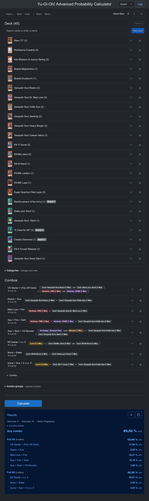

# Yu-Gi-Oh! Advanced Probability Calculator

An exact opening-hand probability calculator for Yu-Gi-Oh! decks accounting for overlapping card roles and distinct physical cards for each positive requirement.

It can model complex combo conditions while correctly accounting for hands that satisfy several combos at once.

**[Try the stable calculator](https://ygo-calculator.pages.dev/)**

> **Development preview:** This README describes the current `dev` branch. You can try that version at **[dev.ygo-calculator.pages.dev](https://dev.ygo-calculator.pages.dev/)**.



## What it can model

- **Reusable and overlapping card roles and properties** - cards can belong to several custom roles and metadata properties at once, such as `VS Starter`, `Attribute: FIRE`, or `Level 5`.
- **Exact unions of overlapping combo routes** - calculate the probability of opening any valid combo without double-counting hands that satisfy several routes, with optional grouping for related combo families.
- **Distinct physical requirements within a combo** - if a route needs both a `Starter` and a `Fire` card, one card that belongs to both does not satisfy both requirements by itself.

Results use combinatorial counting and never fall back on Monte Carlo simulation or approximation.

## Example: Vanquish Soul / K9

The included example uses a Vanquish Soul / K9 deck and models nine underlying routes as eight combo definitions. `VS Starter + (Fire OR Dark)` combines two starter routes into one OR definition. The routes either reach the full Vanquish Soul setup directly or make Ripper + Saryuja as a bridge. Half boards are intentionally not counted.

The example uses three custom role categories:

- `VS Monster`
- `VS Starter`
- `K9 Starter`

Objective properties such as FIRE, DARK, and Level 5 come from card metadata rather than separate user categories. Where a spell functionally represents one of those properties for combo modeling, the example uses a manual metadata assignment.

Common properties are available in card, combo, and draw-filter selectors before a matching card is present. They use the same metadata identity as imported-card properties; specific values such as archetypes and monster types appear when relevant.

Cards can still satisfy several roles and properties at once. For example, Vanquish Soul Razen is both a `VS Monster` and a `VS Starter` and has the FIRE property, while Reinforcement of the Army is assigned the VS Monster and VS Starter roles with a manual FIRE property.

With all eight combo definitions active, the example has an **83.61%** probability of opening at least one modeled full-combo hand.

## How to use it

### Get started

1. **Import or enter your deck.**
2. **Create custom categories** for reusable roles and assign them to cards. Cards can have several categories; imported cards also expose objective properties automatically.
3. **Define combos** with **Add requirement**. Choose a card, category or property from one picker. Click a requirement row to edit its target or counts.
4. **Set counts.** **At least** defaults to one. Open **Maximum: Any** to set an upper bound, or leave it empty for **Any** (the final hand size). Set both counts to `0` to exclude matching cards.
5. **Calculate** to see each combo's probability and the chance of opening any active combo. Hands satisfying several combos count only once in the combined result.

Separate positive requirements need distinct physical copies: one card matching both `Starter` and `Fire` cannot fill both parts of `Starter + Fire`.

### Add OR alternatives and same-card AND conditions

- **OR:** Open a requirement row and choose **Add alternative (OR)**. Select another card, category or property and submit. An OR group needs only one alternative; each keeps its own bounds. Open any alternative to edit it or add another.
- **Same-card AND:** Open a category requirement or alternative and choose **Add property (AND)**. `(Orcust AND Monster) Min 2` needs two cards that each match both properties, using shared bounds. Separate requirements need distinct copies.

Use **Remove requirement** or **Remove alternative** inside the editor. Removing the next-to-last alternative promotes the remaining requirement without changing its bounds. In a same-card editor, change or remove individual properties, then save. Escape or Cancel restores the ordinary add draft. If edits are pending, extension buttons explicitly save those edits before adding an alternative or property.

### Configure draw effects

Expand a card to see its saved simulation. Maintained cards have a **Built-in simulation** defined by their own card-effect class. Choose **Customize simulation** (or **Configure simulation** on an ordinary card), edit the generic settings, and **Save**. **Cancel** discards the draft. **Restore built-in simulation** explicitly reapplies the current definition; matching its values manually still leaves a saved override **Custom**. Supported built-in models have a neutral check icon; partially implemented models show **Partial**. Empty cards without a maintained definition show **No built-in simulation**. **Model notes** appears only for card-specific limitations or saved-version information.

The custom editor offers **None**, **Draw 1**, **Draw 2**, or **Draw 3**. An activating copy is consumed. With **Once per turn** on (the default), later copies of that entry stay in hand; turn it off to let every copy activate, including newly drawn copies. Separate entries have independent allowances.

Open the gear **Calculation settings** menu to choose how these settings apply:

- **Configured draw effects (default):** Apply supported draws, once-per-turn limits, pre-draw costs, removals and eligibility filters.
- **Opening hand only:** Resolve no draws; configured draw cards still occupy initial-hand slots.
- **Simplified draws (hypothetical):** Apply draw counts and once-per-turn limits while ignoring both pre-draw costs and post-draw removals. Cost-dependent cards may draw unconditionally, producing misleading, often optimistic deck-building probabilities.

**Draw activation priority** in the same settings menu defaults to **Encounter order**. Choose **Custom priority** to rank workspace entries, highest first, using the up/down buttons. The highest-ranked legal effect activates after the current draw batch, mill and mandatory removal finish. Newly drawn effects can then overtake earlier waiting effects; a blocked effect waits while another legal effect resolves. Unranked effects follow ranked entries in encounter order. Copies share their entry's priority and existing once-per-turn allowance.

Priority is one fixed policy for all combos and groups, not an optimal-play search. It does not change the shuffle, deck order or cost/removal choices. Rankings are saved with sessions and share links. Renames, visual sorting and inactive entries retain their preferences; duplicated/new entries start unranked, and replacing/importing a deck clears the old ranking. Switching back to Encounter order ignores the saved ranking.

**Advanced → Banish from deck** sets a hidden top-deck cost before drawing. The built-in Pot of Desires simulation banishes 10 then draws 2, requiring at least 12 cards left in deck. Only physical deck size is tracked: banished identities and remaining combo resources are not simulated. Simplified draws ignores this cost.

Solar Recharge discards one card that is both a Lightsworn and a Monster, draws 2, then sends the top 2 deck cards to the GY. It requires at least 4 cards left in deck. Milling reduces deck capacity before subsequent draws; milled identities and GY effects are outside the model. Simplified draws ignores both its discard and milling. Custom edits preserve the saved milling operation; choosing None removes the entire draw effect, and Restore built-in simulation restores the complete plan.

Requirements apply to the final hand. If the full draw amount is unavailable, the source stays in hand and the outcome is evaluated normally.

### Use Advanced costs and removals

With a draw amount set, **Before drawing** and **After drawing** can each remove one or two cards. **Eligible** accepts any card, a category/property, a same-card AND group, or OR alternatives.

- A pre-draw cost must be payable without using the activating copy. Otherwise the effect waits and may be reconsidered after another activation.
- A required post-draw removal can use newly drawn cards. If eligible material is missing after a legal draw, that branch fails and remains in the probability denominator.
- Removal follows a deterministic policy: keep cards matching positive requirements in active routes first, then usable draw cards, then other cards. Changing active routes can change the resulting hands.

Results are exact for this policy, **not optimal-play simulation**. Optional activation, searches, discard triggers, and general card effects are unsupported.

Recognized imports and database selections receive authoritative built-in definitions. Saved cards retain their exact plan, source, revision and limitations until explicitly changed or restored; older snapshots are labeled **Saved simulation**. An unavailable execution model is reported rather than replaced with generic draws. Choosing **Draw None** clears pre- and post-draw configuration. Simplified mode and **Storage safety limit** are runtime preferences, not session fields. New workspaces and restored ON sessions use configured effects; saved OFF sessions restore opening-hand-only. Re-enabling effects selects configured behavior.

A small pre-calculation notice flags potentially expensive draw configurations without blocking Calculate. If a request is slow or reaches a Work or Storage limit, **Calculate without draw effects** explicitly runs an exact alternative for that request. It preserves configured settings and the saved preference. This answers a different question and is not a guaranteed lower bound. Results and copied/pinned comparisons identify the model used; the next ordinary Calculate uses the selected setting.

See the calculator's [Help page](https://dev.ygo-calculator.pages.dev/help) for detailed rules and built-in examples.

## How the calculation works

The calculator uses exact combinatorial counting rather than simulation. Each combo is reduced to constraints over the physical cards that can satisfy it. Overlapping categories are normalized while still ensuring that separate positive requirements need separate card copies.

To enforce distinct physical copies across overlapping requirements, the calculator applies Hall’s matching condition to the sets of cards eligible for each requirement.

Independently of user-authored OR groups, compatible alternatives can sometimes be factored into a simpler equivalent condition:

```text
(X AND A) OR (X AND B) = X AND (A OR B)
```

When several combos overlap, compatible constraints are merged, impossible intersections are discarded, and equivalent overlaps only need to be counted once.

Because one opening hand can satisfy several combos, their probabilities cannot simply be added. The calculator uses inclusion-exclusion to avoid double-counting:

```text
P(A OR B) = P(A) + P(B) - P(A AND B)
```

The same principle extends to larger sets of combos.

With draw-only effects, an exact count-state dynamic program produces weighted scenarios. Each scenario fixes retained duplicate effect cards and counts the remaining ordinary cards with the same Hall constraints. Scenario probabilities are combined as exact fractions before converting the final results for display.

Pre-draw costs and post-draw removals use a separate bounded count-state resolver that tracks hand composition, remaining multiplicities, encounter-ordered candidates with an optional activation priority, and used once-per-turn entries; equivalent ordinary entries and resolution states are merged. Exact integer weights count labeled draw prefixes and their unseen suffixes. Final hands are evaluated against the same compiled Hall constraints, and results are converted for display only after exact aggregation.

Cards that behave identically for the remaining conditions are grouped together, and exact combinatorial counts are used to determine how many opening hands succeed without checking every physical hand one by one.

```text
              matching opening hands
P(success) = ------------------------
              all possible opening hands
```

## Features

- Require categories, individual cards, or both within a combo.
- Set minimum counts and either fixed maximums or `Any` (the current hand size) for requirements.
- Calculate individual combo probabilities, grouped probabilities, and the union of all active combos.
- Organize related combos into named groups.
- Import decks from `.ydk` files or YDKe deck codes.
- See automatic card thumbnails in the deck list and a larger preview in an expanded imported-card editor. Images are retained on project hosting; unavailable artwork does not affect calculations or saved sessions.
- Save and load complete calculator sessions.
- Temporarily deactivate cards and combos while testing changes.
- Reorder cards, categories, combos, and combo groups.
- Color-coded categories.
- Light, dark, and system themes.

## Technical stack

- **Blazor WebAssembly**
- **.NET 10**
- **C# 14**
