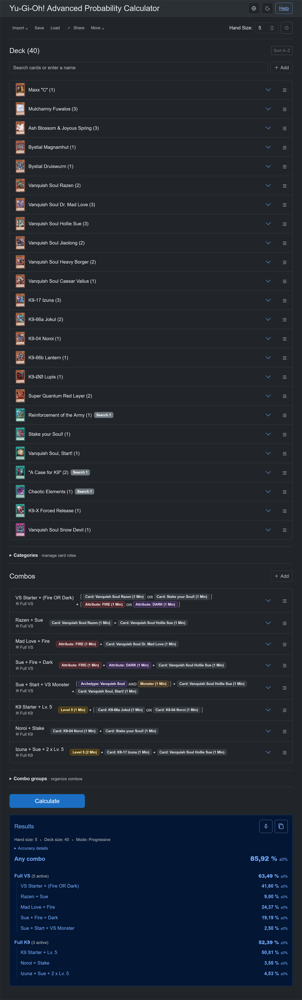

# Yu-Gi-Oh! Advanced Probability Calculator

Calculate opening-hand combo probabilities for Yu-Gi-Oh! decks with overlapping card roles, distinct physical requirements, and configured effects. The engine uses combinatorial counting, not Monte Carlo sampling. Each result reports its accuracy for the configured model.

**[Try the stable calculator](https://ygo-calculator.pages.dev/)** · **[Development preview](https://dev.ygo-calculator.pages.dev/)** · **[How to use it](https://dev.ygo-calculator.pages.dev/help)**

This README is updated before each release and may not reflect the latest development changes.



## What it models

- **Effect simulation.** Simulate supported draw, excavation, and search effects, including conditional effects.
- **Distinct physical copies.** Separate positive requirements such as `Warrior + Fire` need different copies. A single copy of Vanquish Soul Razen cannot fulfill both.
- **Overlapping properties and combos.** A card can match several properties, and a hand can satisfy several combos. Group totals and **Any combo** count each successful outcome only once.

## Modes and accuracy

The model resolves draw effects first, then up to one excavation, followed by search effects. It checks whether any legal combination of search targets can satisfy each combo, without committing each search effect to a particular target. This fixed order can differ from optimal play, even when the result is exact for the model.

Random banishes and mills can remove search targets from the deck. Fast can sometimes account for these losses statistically, or prove they cannot affect the result, without tracking the identity of every remaining card. Most practical calculations produce an exact result; others may be bounded by a certified range or be uncertified, with no proven error range.

When Fast is not exact, the default Progressive mode attempts an exact calculation. Some combinations of effects make this substantially more expensive. You can also choose Fast only, Exact only, or calculate without effect simulation.

See [accuracy and performance](docs/accuracy-and-performance.md) for the precise contracts and [the calculation model](docs/calculation-model.md) for supported operations and exclusions. For the mathematics behind counting, including inclusion-exclusion and Hall-style matching, see [the probability engine](docs/probability-engine.md).

## Start with a deck

1. Import a `.ydk` file or YDKe code, or enter cards manually. Set the opening hand size.
2. Assign reusable categories if needed. Imported metadata properties are available alongside custom roles.
3. Define combos using card identities, categories, and properties. Combine alternatives or properties as needed.
4. Calculate.

You can save and share sessions, organize combos into groups, and pin results for comparison.

## Example: Vanquish Soul / K9

The bundled session shows how to define Vanquish Soul and K9 combos using card identities and properties, including alternatives such as `VS Starter + (Fire OR Dark)`. With all combos active, the exact chance of reaching any combo is **85.92%**. Open the [Help page](https://dev.ygo-calculator.pages.dev/help) and choose **Try It with Example Data** to explore the setup.

## Documentation and development

Start with the [documentation index](docs/README.md). It links to the user guide, calculation model, probability explanation, and accuracy and resource reference.

The app uses **Blazor WebAssembly, .NET 10, and C# 14**. With a .NET 10 SDK:

```sh
dotnet restore YGOProbabilityCalculatorBlazor.sln
dotnet build YGOProbabilityCalculatorBlazor.sln --no-restore
dotnet test YGOProbabilityCalculatorBlazor.sln --no-build
dotnet run --project YGOProbabilityCalculatorBlazor/YGOProbabilityCalculatorBlazor.csproj
```

Install SDK-scoped `wasm-tools` for optimized Release publishing. [Worker/runtime notes](scripts/background-calculation/README.md) contain implementation and historical benchmark evidence.

Card artwork is supplied by [YGOPRODeck](https://ygoprodeck.com/api-guide/) and retained on project hosting. The software license does not cover third-party artwork.

Translation data compilation is credited to [YAML Yugi](https://github.com/DawnbrandBots/yaml-yugi) and its upstream contributors. Card content remains the property of its respective rights holders; the software license does not relicense it. See the [offline source and coverage guide](infrastructure/card-catalog/README.md#german-search-names).
